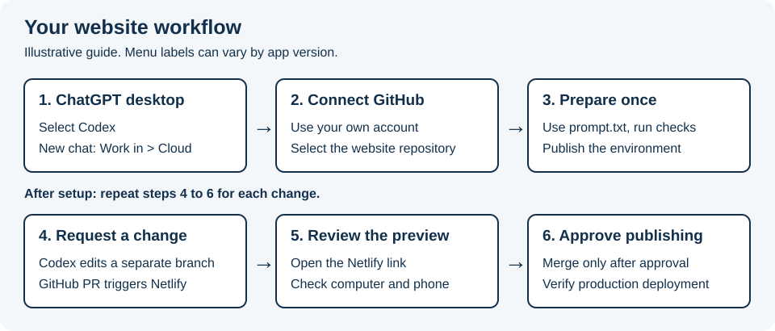

# Edit the website with Codex Cloud

Use the ChatGPT desktop app, your own GitHub account with repository access,
and a prepared cloud environment. You do not need a local folder or developer
tools on your Windows PC or Mac. Review changes through Netlify preview links.



## 1. Open Codex and choose Cloud

In the ChatGPT desktop app, use the top-left mode menu to select **Codex**.
Start a new chat and choose **Work in > Cloud**. Selecting a sidebar project
alone does not choose the execution environment. Labels may vary by app version.

If Cloud is missing, check your account and workspace access with your administrator.
Do not attach an empty local folder as a workaround for this cloud workflow.

## 2. Prepare the environment once

Select an existing published **Site Sentinel Website** environment if available.
Otherwise choose **Select environment > Create environment**, connect GitHub when
prompted, and select:

<https://github.com/Site-Sentinel/sitesentinel-website>

Use your own authorised GitHub account. Being able to read this public repository
does not prove you can push branches or merge changes. Ask the repository owner
for the appropriate access if needed. Never paste passwords or tokens into chat.

Choose **Get started**. Copy [prompt.txt](../prompt.txt) into the setup conversation.
The assistant should use Node from `.node-version`, pnpm from `package.json`,
and run these commands in the cloud workspace:

```bash
pnpm install --frozen-lockfile
pnpm check
pnpm build
```

Allow the package downloads needed for setup. If network or GitHub access fails,
resolve it before starting website work. No product database, Rails checkout or
production secrets are needed. Netlify deploys through its GitHub integration;
contributors do not need a shared Netlify password or deployment token.

Review the setup report, resolve failures, and select **Publish** for the environment.
This prepares future cloud tasks. It does not publish the website. Start a new
task using the published environment and ask the assistant to confirm repository
access and rerun the checks. This first real task validates the prepared setup.

Official reference: [Cloud environments](https://learn.chatgpt.com/docs/environments/cloud-environments).
This guide describes the intended workflow; it does not confirm that your account
has Cloud access or that this environment has already been configured and tested.

## 3. Give another maintainer access

OpenAI documents shared environments within an Enterprise workspace. Where your
workspace supports it, use the environment's **Privacy > Who can use** setting to
share the prepared setup. Each person gets separate task files and still needs
their own repository permissions. Verify the options available in your account;
do not assume sharing works between unrelated personal accounts.

If sharing is unavailable, each person can prepare an environment using the same
repository and prompt. Keep the setup instructions in this repository consistent.
After changing environment setup, republish it and test a new task.

This site needs no secret environment variables. If that changes, review the need
first. Use environment configuration for shared non-secret values and the Personal
vault for credentials each person must supply. Sharing credential requirements
does not share someone's personal saved credentials. Never commit an `.env` file.

## 4. Check publishing safeguards once

Ask the repository administrator to verify:

- GitHub protects `main` against direct pushes and requires pull requests plus
  successful Checks, Architectural rules and the actual Netlify preview check.
- Netlify is connected to this repository, builds production from `main`, and
  has pull request Deploy Previews enabled.
- The production address and who may approve and merge changes are agreed.

These are external settings. Written repository rules do not enforce them.
Do not change DNS or the product application's configuration during a website edit.

## 5. Request a change

Start a new task using the published environment and paste:

```text
Read AGENTS.md and README.md in the Site Sentinel website repository.
Make this change: [describe the exact change].
Confirm repository access and preserve any existing work. Fetch origin and
create a descriptive feature branch from current origin/main.
Make only the requested change. Run pnpm check and pnpm build in the cloud.
Commit and push the branch, then open a pull request targeting main.
Wait for the GitHub checks and Netlify Deploy Preview to succeed.
Give me the actual PR and preview links, with a plain-language change summary.
Use Chrome browser control to inspect desktop and phone layouts if available.
If it is unavailable, ask me to review those layouts and record my review.
Do not merge or publish until I explicitly approve the current preview.
```

The assistant handles the code and branch. You describe the desired result and
review the preview. A cloud `localhost` address is not a link you can review on
your computer. Wait for the actual Netlify preview address.

If the assistant cannot push or open a PR, it must report that limitation and
help resolve GitHub access. Do not move unfinished changes onto `main` to publish.

## 6. Review the preview

Open the latest Netlify preview on your computer and phone. Check the changed
wording, images, buttons and layout. Ask for corrections in the same cloud task;
the same branch and PR receive the updates. Wait for checks and review again.

Chrome browser control is the approved tool for assistant visual checks.
Playwright is prohibited. A cloud task may not have access to your local Chrome.
If it cannot inspect the preview, review it yourself and report the result.
The assistant must state who checked which preview and what remains incomplete.
Passing source checks alone does not prove the page looks right.

Preview links are shareable, not private storage. Use approved public artwork
and fictional data. Do not upload real customer screenshots or private records.

## 7. Approve and publish

When you are happy with the current preview and checks have passed, say:

```text
I have reviewed this preview on desktop and phone. I approve publishing this
version. Merge the PR, verify the production deployment for the merged commit,
and give me the production link and any remaining limitations.
```

The assistant may merge only with that explicit approval and sufficient access.
If it cannot merge, an authorised maintainer can merge the approved PR on GitHub.
Netlify then builds production. A merge alone is not proof of deployment: check
that the deployment succeeded and inspect the deployed result.

Keep corrections in the same task until complete. For a separate change, start a
new task from current main. Do not let two people edit the same branch at once.
A separate ChatGPT Project can hold discussions, but supply the agreed brief to
the coding task rather than assuming other chats or uploaded files are available.

The [visual publishing guide](how-deploys-work.html) can also be downloaded and
opened in a browser. The diagram above is visible directly in this GitHub guide.
