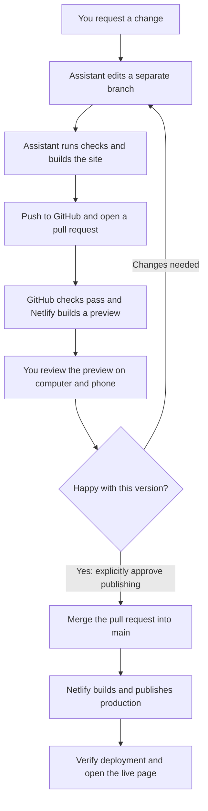

# From your request to the live website

You describe the change in ChatGPT desktop. The assistant prepares a preview.
You review it before approving publication.

This guide describes **website publication**. Publishing a development environment
instead saves the machine setup for future tasks; it does not change the live site.
A chat does not automatically create a branch or PR. The assistant must perform
those actions using the access available to that task. See the
[setup and access guide](getting-started.md) if an operation is blocked.

> **Your approval is required before publishing.** Asking for a change authorises
> a preview, not a production release.

## The path to publishing

## What you do and what the assistant does

| Stage   | You                                                     | Assistant and services                                                                                  |
| ------- | ------------------------------------------------------- | ------------------------------------------------------------------------------------------------------- |
| Request | Describe the change in plain language.                  | Read the repository rules and create a separate branch from current main.                               |
| Prepare | Wait for the preview link.                              | Make the edit, run checks and build, then push and open a pull request.                                 |
| Preview | Open the Netlify link on computer and phone.            | Wait for GitHub checks and the preview to succeed. Explain the changes and any incomplete verification. |
| Correct | Describe anything that needs fixing in the same chat.   | Update the same branch and PR, rerun checks and provide the updated preview.                            |
| Approve | Explicitly approve the current preview for publication. | Merge only after approval and with sufficient GitHub access.                                            |
| Publish | Open the confirmed live link.                           | Verify Netlify deployed the merged commit and inspect the result. Report any limitations.               |

## What the names mean

| Name              | Meaning                                                                                              |
| ----------------- | ---------------------------------------------------------------------------------------------------- |
| Branch            | A separate copy of the work, keeping unfinished edits away from production.                          |
| Pull request (PR) | A proposal to put the branch's changes into main.                                                    |
| Preview           | A separate Netlify website showing the proposed change. It is shareable but is not production.       |
| Main              | The GitHub branch Netlify uses for the production website.                                           |
| Merge             | Accept the PR's changes into main. This triggers deployment; it does not prove deployment succeeded. |

## When you are ready to publish

After reviewing the latest preview on computer and phone, tell the assistant:

> I approve publishing this preview. Merge the PR, verify the production
> deployment and give me the confirmed live link.

If more edits are made afterwards, review the updated preview and approve again.
If the assistant lacks merge permission, an authorised maintainer must merge the
approved PR on GitHub. GitHub automatically deletes the merged branch when the
repository's automatic deletion setting is enabled.

## If something goes wrong

- **A check fails:** the assistant fixes the cause and pushes again. Do not bypass it.
- **The preview needs changes:** continue in the same chat, branch and PR.
- **The assistant cannot inspect the page:** review the preview yourself on computer
  and phone and report what you checked. It must not claim it performed that review.
- **No merge button:** confirm the GitHub account signed into your browser has write
  access. A different account used by the assistant may have different permissions.
- **Merged but not live:** check the Netlify deployment for the merged commit.
  A merge alone is not proof of a successful deployment.

## Administrator checks

Verify that GitHub protects main and requires successful PR checks, and that
Netlify uses main for production with Deploy Previews enabled. These are external
settings; this guide does not establish that they are enabled.

Keep private information out of previews and this public repository.

[Get started in ChatGPT desktop](getting-started.md) · [Full assistant rules](../AGENTS.md)
